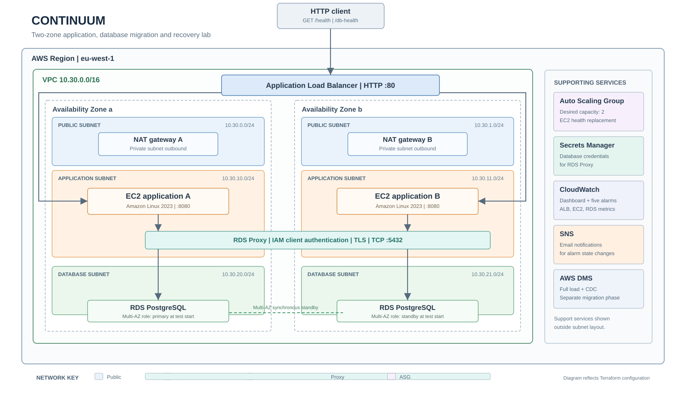

# Continuum | AWS High Availability and PostgreSQL Migration

Continuum is an AWS infrastructure project built with Terraform to explore how a web application and its database respond to failures. I wanted to test more than whether individual services could be deployed. The main focus was on how the components work together during an EC2 replacement, a database failover and a PostgreSQL migration.

The application runs on two private EC2 instances across Availability Zones in Ireland (`eu-west-1`). An Application Load Balancer routes requests to the instances, and RDS Proxy provides an IAM-authenticated connection to a Multi-AZ PostgreSQL database. AWS DMS was used separately to migrate a sample dataset and replicate subsequent changes. CloudWatch and SNS were added to observe the environment during testing.

## Architecture



[Architecture and request paths](docs/architecture.md) | [Interactive recovery walkthrough](docs/interactive/index.html) | [DMS migration](docs/architecture.md#postgresql-migration) | [Monitoring](docs/architecture.md#monitoring-and-alerting)

The recovery walkthrough is an HTML page with selectable EC2 and RDS failure scenarios. Once GitHub Pages is enabled, it can also be opened as a standalone website.

## What I built

| Area | Implementation |
| --- | --- |
| Networking | Custom VPC, six subnets in two Availability Zones, two NAT gateways and separate subnet route tables |
| Application | Internet-facing ALB, two private Amazon Linux 2023 EC2 instances and a Python service started by `systemd` |
| Instance recovery | Auto Scaling Group maintaining two instances, using ALB health checks for replacement |
| Database | Private, encrypted PostgreSQL 17 RDS instance with Multi-AZ standby |
| Database access | RDS Proxy, TLS and IAM authentication from the application; credentials stored in Secrets Manager |
| Migration | AWS DMS full load followed by change data capture (CDC) from a separate PostgreSQL source |
| Monitoring | CloudWatch dashboard, five alarms and SNS email notifications |

The application exposes `/health` to check the HTTP service and `/db-health` to run `SELECT 1` through RDS Proxy. These endpoints let me examine instance availability and database connectivity separately. The Auto Scaling Group keeps a fixed capacity of two instances; the exercise focused on replacement rather than load-based scaling.

## What the tests showed

| Exercise | Result |
| --- | --- |
| EC2 replacement | 148 of 148 sampled `/health` requests returned HTTP 200. Two healthy targets were restored in approximately 2 minutes and 1 second. |
| RDS Multi-AZ failover | 99 of 101 sampled SQL-backed requests succeeded. Two requests timed out after 8 seconds. |
| PostgreSQL migration | 1,000 rows transferred during full load. After 10 inserts, 5 updates and 5 deletes, source and target contained 1,005 rows with matching aggregate results and an ordered row checksum. |
| Alerting | CloudWatch alarm-state testing delivered notifications through SNS to the confirmed email subscription. |

The figures describe individual, controlled test windows. They are not long-term availability measurements. Details, including the migration checks and the limits of each exercise, are in [Validation results](docs/validation-results.md).

## Repository and documentation

```text
app/                 Python HTTP application
sql/                 PostgreSQL source data and CDC test statements
terraform/           Main infrastructure configuration
terraform/phase3-archive/  DMS configuration used during the migration phase
docs/                Architecture, design decisions, validation and deployment guidance
```

- [Architecture](docs/architecture.md): Network layout, request path, RDS Proxy, DMS and monitoring.
- [Design decisions](docs/design-decisions.md): Why the major components were chosen and the trade-offs involved.
- [Validation results](docs/validation-results.md): Recovery observations, migration checks and test scope.
- [Deployment and teardown](docs/deployment.md): Prerequisites, manual setup, cost considerations and cleanup.

## Running the project

The lab infrastructure was destroyed after testing. Rebuilding it requires an AWS account, Terraform, a prepared state backend and database credentials. The DMS phase also needs database-level setup and is stored separately from the active Terraform module. Start with the [deployment guide](docs/deployment.md) and review AWS costs before provisioning anything.

This repository presents a tested engineering lab rather than an always-running service. The ALB used HTTP for the test application, and the environment did not implement demand-based scaling or cross-Region disaster recovery.
