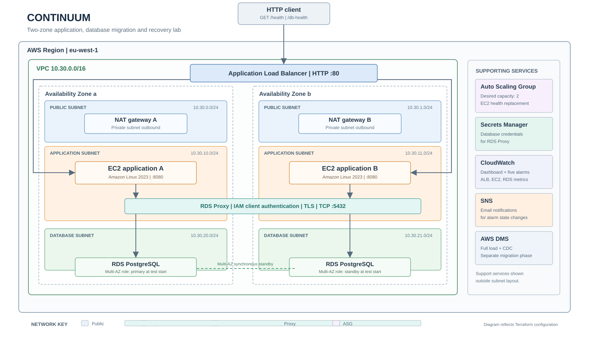
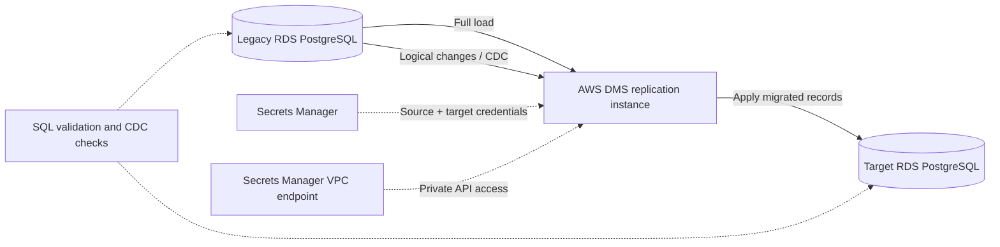
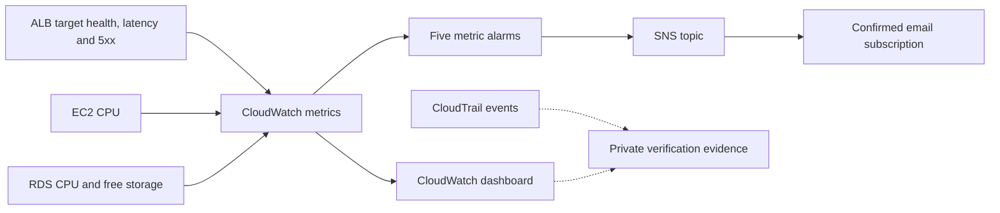

# Architecture

The architecture was designed around a simple question: if one part of the application becomes unavailable, which other parts can continue operating, and how can the interruption be observed?

## Network and application

The infrastructure is deployed in `eu-west-1` using a custom VPC (`10.30.0.0/16`). Each of the two Availability Zones has a public subnet, an application subnet and a database subnet. The public subnets contain the NAT gateways and provide the network placement for the internet-facing ALB. The application instances run without public IP addresses.

Traffic enters through the ALB on port 80 and is forwarded to the Python application on port 8080. The application runs as a `systemd` service on Amazon Linux 2023. The Auto Scaling Group maintains two instances and uses ELB health checks to replace an unhealthy target. Since its minimum, desired and maximum capacity are all two, it does not expand in response to increased traffic.

Each application's outbound internet route points to the NAT gateway in its own Availability Zone. The database subnets have no default route to the internet. Security groups restrict inbound application traffic to the ALB and inbound database traffic to RDS Proxy.

## Database connection path

The application connects to RDS Proxy over TLS using an IAM database authentication token. RDS Proxy reads the corresponding database credentials from Secrets Manager and connects to the PostgreSQL instance. PostgreSQL uses encrypted gp3 storage and a Multi-AZ standby.

Two health endpoints deliberately test different dependencies:

- `GET /health` confirms that the Python HTTP service is responding. This is the ALB health check.
- `GET /db-health` generates an IAM authentication token, connects through the proxy and executes `SELECT 1`. It reports HTTP 503 if the database check fails.

A successful `/health` response therefore does not guarantee that the database is reachable. This distinction was important when comparing EC2 replacement with RDS failover.

## PostgreSQL migration

For the migration exercise, a separate PostgreSQL source database was configured for logical replication. AWS DMS performed the initial full load and then captured inserts, updates and deletes from the source. DMS accessed its source and target credentials through Secrets Manager, using a VPC interface endpoint for private access to the service.

The source data and CDC operations are represented in the two SQL files under `sql/`. The migration resources are retained in `terraform/phase3-archive/` as an implementation record. They are not automatically loaded by Terraform when working in the main `terraform/` directory. The migration phase also required manual database privileges and credential setup.

[Migration results](validation-results.md#postgresql-full-load-and-cdc)

## Monitoring and alerting

CloudWatch collected ALB, EC2 and RDS metrics. A dashboard provided a consolidated view of request activity, target health, response time and database behaviour. Five CloudWatch alarms covered ALB healthy-target capacity, target errors, EC2 CPU, RDS CPU and RDS free storage. Alarm notifications were routed through SNS to a confirmed email subscription.

An alarm state was deliberately changed during testing to verify notification delivery. This checked the alerting path rather than demonstrating that a natural performance threshold had been breached.

## Recovery exercises

The [interactive recovery walkthrough](interactive/index.html) follows two controlled tests: terminating an EC2 instance and initiating an RDS Multi-AZ failover. Each scenario shows the sequence of events and the corresponding HTTP observations. The walkthrough illustrates the process; it is not a live AWS dashboard.
